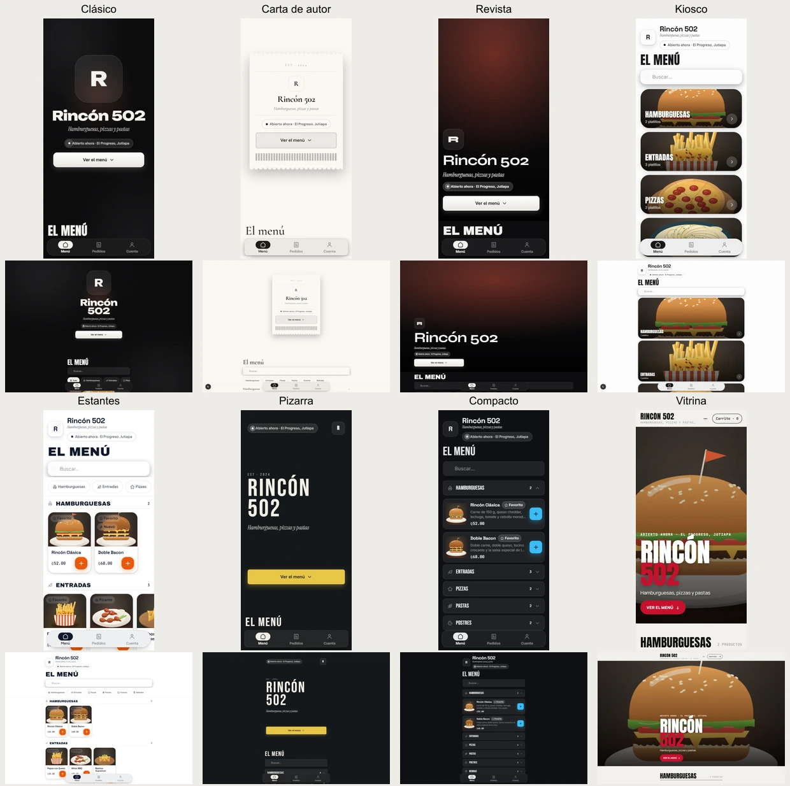

# Auditoría del menú digital · 18 de noviembre de 2026

## Decisión propuesta

La primera inversión debería facilitar que quien ve un platillo pueda encontrarlo, conocer su precio y pedirlo. El restaurante ya tiene ocho maneras reconociblemente distintas de presentarse. Añadir otra plantilla resolvería menos que corregir dos fallos de interacción y conectar la publicidad de un platillo con su ficha.

Hay dos primeras visitas diferentes. Quien escanea en mesa ya eligió restaurante y quiere comparar o pedir. Quien llega desde una publicación todavía necesita una razón para elegirlo, pero ya mostró interés en un producto concreto. Conservar la entrada directa que hoy ofrece el QR de mesa. Para redes, probar una llegada directa al producto anunciado. Reservar la portada completa para quien abre el enlace general y está conociendo el negocio.

## Qué se observó

Base de código `069a6d10` de main. Muestra local de Rincón 502 en Chrome mediante Playwright, a 390 × 844 y 1280 × 900, con 13 platillos y seis categorías. Las 16 capturas proceden de la ruta real `/preview/muestra?estilo=…` en el entorno de trabajo `3ba4eb1d`. El catálogo, la ficha y el carrito coinciden con la base auditada. En el registro de plantillas cambian dos textos de ayuda del editor. La prueba de volumen se ejecutó sobre la base de main. Se usaron paletas de firma claras y oscuras. Las ilustraciones son las que distribuye la demo.

Las posiciones siguientes son coordenadas CSS del borde superior del primer nombre «Rincón Clásica», desde la parte superior del documento, redondeadas. Corresponden al enlace general, con la página arriba. La guía del proyecto sitúa lo principal en el primer tercio del teléfono, aproximadamente 281 px en esta muestra. En Kiosco se mide la categoría porque hasta elegirla aún no hay precios. Una portada puede justificar ese espacio si ayuda a elegir el local. El coste de oportunidad se debe medir por canal.

| Estructura y estilo de prueba | Primer nombre en móvil | Qué comunica y dónde funciona | Qué probar antes de recomendarla al dueño |
|---|---:|---|---|
| Clásico · carbon-autor | 1,003 px | Firma y llamada a entrar muy claras. Sin logo cargado, una «R» ocupa el principal espacio de marca. En PC la composición sigue siendo estrecha. | Comparar portada con logo real y portada compacta en un local de pedidos frecuentes. Medir tiempo hasta ver un precio. |
| Carta de autor · carta-autor | 969 px | La portada parece un ticket físico. Las líneas de texto permiten comparar precios sin depender de fotografía. | Bistró o vinos. Usar nombre, ingrediente o procedencia y porción cuando el dueño los confirme. Revisar nombres de dos líneas, precios largos y el año impreso. |
| Revista · revista | 1,052 px | El mosaico permite dar protagonismo a un plato. La entrada de la muestra dedica gran superficie a un fondo sin comida. En escritorio esa ausencia pesa más. | Presentar al dueño la portada con su propia foto y sin ella. Revisar recorte, luz del plato y legibilidad en ambos anchos antes de elegirla. |
| Kiosco · kiosco | Categoría a 324 px | Las portadas de categoría hacen reconocible la oferta. Un toque para entrar en la sección antes de comparar productos. | Conveniente si las familias se distinguen de verdad. Con una sola categoría útil, ensayar acceso directo a sus productos y medir el toque ahorrado. |
| Estantes · estantes | 491 px | Deja explorar varias familias pronto. El encabezado, el buscador y las categorías preceden a las tarjetas. Hay dos direcciones de desplazamiento. | Corregir desborde y comprobar con el dedo que avanzar por una repisa conserva la posición vertical. Es la primera candidata a prueba con carta grande. |
| Pizarra · pizarra | 923 px | Portada tipográfica con mucha personalidad. Las secciones plegables favorecen una carta que cambia con frecuencia. | Bar con oferta del día. La apertura de muestra posterga el producto. Comparar conservar el cartel en redes y una cabecera breve en visitas repetidas. |
| Compacto · compacto | 325 px | La primera sección está abierta y deja comparar nombre, descripción y precio. Las demás ocupan una fila cada una. | Buena candidata para una carta extensa o sin fotos. Probar que el cliente encuentre un plato en la última sección y vuelva al mismo lugar después de editarlo. |
| Vitrina · vitrina-cereza | 1,341 px | La imagen domina desde el primer pantallazo. Es la muestra con mayor distancia hasta el nombre en la ficha de catálogo. Navegación superior propia. | Para colecciones cortas con fotos buenas. La imagen de portada puede comunicar el producto mucho antes que su nombre. Probar si el visitante identifica qué compra, cuánto cuesta y si sigue disponible. |

Los anchos de contenido de 460, 760 y 1120 px responden al diseño elegido por el dueño. El espacio lateral en PC forma parte de esa decisión. Mantener esos límites en las primeras correcciones. El criterio comercial para elegir estructura debería ser la carta del negocio: cuántos platos tiene, cuántas buenas fotos puede mantener y si el cliente suele explorar o ya sabe qué pedir. Las 8 estructuras y 26 paletas producen 208 combinaciones. Las capturas cubren ocho.

## Recorridos y funcionalidad

| Intención | Recorrido observado o trazado | Consecuencia para el diseño |
|---|---|---|
| Consultar en mesa | El código omite la portada con parámetro de mesa positivo, valida la mesa y avisa si es inválida. Mirar la carta requiere cero toques de entrada. | Conservar la identidad en la cabecera breve. Al probar un cambio incluir QR válido, inválido y reapertura desde el icono instalado. [Entrada](../../plataforma/src/components/menu-shell.tsx) |
| Añadir un plato simple | En Estantes, clic en «Agregar Papas con Queso» deja «1 · Ver carrito · Q35.00». Un toque para añadir, otro para revisar. | Mantener la confirmación con importe. Medir también el camino con teclado, que hoy abre otra pantalla. |
| Configurar una hamburguesa | En Compacto, «+» abre la ficha. Rincón Clásica muestra Q52.00, término obligatorio, hasta tres extras y acompañamientos separados. La acción inicial dice «Elige término de la carne». | El recorrido previsto con tocino es abrir, elegir término, elegir tocino, agregar y abrir carrito, cinco acciones. El precio esperado es Q62.00. Se vio la ficha y sus importes. La comprobación automatizada de ese total en carrito quedó pendiente. [Ficha y reglas](../../plataforma/src/components/menu/product-sheet.tsx) |
| Consultar sin pedir | Catálogo y ficha reciben `ordersEnabled`. El control de compra y el carrito dependen de ese permiso. Las etiquetas dietéticas tienen tratamiento separado de las promocionales. | Evaluar este modo por lectura, búsqueda y consulta de ingredientes. Medir conversión a pedido solo en sesiones con canal habilitado. |
| Completar y seguir | El carrito lleva a checkout. El formulario compone tarifa, descuento y propina, comprueba zona y conserva identificador de reintento. La confirmación y «Pedidos» ofrecen continuidad tras el envío. | En local de prueba cubrir mesa, recogida, entrega dentro y fuera de radio, local cerrado y pérdida de conexión al confirmar. Exigir un solo pedido, total consistente y distinción entre pendiente y recibido. Revisión de código, sin transacción real. [Checkout](../../plataforma/src/components/checkout-form.tsx) |

## Hallazgos priorizados

P1 indica pérdida de una acción principal, información comercial incorrecta o riesgo para la disponibilidad de la carta. P2 identifica fricción con alternativa o mejora que merece validación. Las hipótesis de ventas se evalúan aparte. Las rutas y líneas corresponden a la base indicada.

| ID | Evidencia y efecto | Cambio propuesto y prueba de aceptación |
|---|---|---|
| M01 · P1 · teclado | En Estantes, enfocar «Agregar Papas con Queso» y pulsar Enter abre su ficha. Un clic en ese mismo control añade Q35.00. La tarjeta externa también tiene rol de botón y procesa Enter/Espacio de sus hijos. [ui.tsx, línea 47](../../plataforma/src/components/menu/ui.tsx#L47) | Dar acciones independientes a «Ver» y «Agregar». Verificar con Tab, Enter y Espacio en tarjeta, fila, destacado y mosaico. Una activación debe ejecutar exactamente la acción anunciada y conservar foco útil. |
| M02 · P1 · carga fallida | La consulta pública recoge `data` sin comprobar `error`. Un fallo de productos puede transformarse en lista vacía y el resultado entra en la caché con revalidación de 60 s. Para el comensal se parece a un restaurante sin oferta. Hallazgo de código. [menu.ts, línea 126](../../plataforma/src/lib/db/menu.ts#L126) | Distinguir fallo de lectura y carta vacía legítima. Probar fallo de categorías y de productos por separado, recuperación en la siguiente lectura y mensaje breve con reintento. Conservar en caché únicamente una lectura válida. |
| M03 · P1 si se usa EN · búsqueda | El cliente puede leer un nombre traducido, pero el filtro solo consulta nombre y descripción base y etiquetas. Quien copie la palabra inglesa visible puede obtener cero resultados. [catalog.tsx, línea 278](../../plataforma/src/components/menu/catalog.tsx#L278) | Incluir nombre y descripción localizados. Probar «limonada» y «lemonade» con un producto bilingüe, acentos, búsqueda vacía y traducción ausente. Revisar también el mensaje de cero resultados y el nombre accesible de «Agregar» en EN. |
| M04 · P2 · Estantes | Documento de 446 px a 390, 376 a 320 y 820 a 768. En 1280 midió 1280. A 390 se pudo desplazar horizontalmente el documento. El movimiento de una repisa puede confundirse con el de toda la página. [Carrusel](../../plataforma/src/components/menu/catalog.tsx#L757) | Localizar el elemento que extiende la página. Mantener el desplazamiento de cada repisa. Aceptación en 320, 390, 768 y 1280, con `scrollWidth === clientWidth` en la raíz, último artículo alcanzable, teclado y gesto diagonal en dispositivo físico. |
| M05 · P2 · veracidad de marca | Carta de autor y Pizarra imprimen «EST · 2024» en las capturas. El texto procede del valor inicial compartido. Para un restaurante nuevo puede aparentar un año de fundación falso. [defaults.ts, línea 668](../../plataforma/src/lib/theme/defaults.ts#L668) | Dejar el rótulo opcional y conservar el texto que el dueño ya personalizó. Comprobar restaurante nuevo, dato explícito y carta antigua antes de tratar el valor heredado. |
| M06 · P2 · capacidad | Los datos públicos se consultan sin paginación. El límite configurado en el repositorio es de 1,000 filas. Al superarlo, una carta podría quedar incompleta sin indicación. Falta comprobar el ajuste del entorno desplegado. [Consulta](../../plataforma/src/lib/db/menu.ts#L133) · [configuración local](../../plataforma/supabase/config.toml#L18) | Sembrar 999, 1,000 y 1,001 productos activos en un local aislado. Comparar IDs publicados con IDs visibles y buscables. Si se admite ese volumen, paginar con orden estable y desempate por ID. Si existe límite comercial, hacerlo visible antes de publicar. |

## Rendimiento y capacidad

Se midió el crecimiento de **Estantes**, una de las estructuras que dibuja productos de todas las secciones. Se montó temporalmente el componente real de vista previa en main con seis categorías y filas sintéticas copiadas cíclicamente de los 13 productos de la demo, identificadores y nombres únicos. Chrome a 390 × 844, Next en desarrollo con webpack, sin ralentización artificial. Se contó el HTML inicial sin comprimir mediante GET y los elementos de `body` tras hidratar. El entorno de desarrollo añade sus propias estructuras. Estas cifras sirven para comparar tamaños dentro de la prueba.

| Productos | HTML inicial en bytes | Elementos DOM |
|---:|---:|---:|
| 13 | 92,435 | 341 |
| 100 | 372,105 | 1,663 |
| 500 | 1,656,282 | 7,726 |

Al pasar de 100 a 500 productos, el HTML creció 4.45 veces. Se reutilizaron las mismas imágenes, de modo que un restaurante con una foto distinta por plato puede añadir otro coste de red. El catálogo ya evita parte del pintado fuera de pantalla con `content-visibility`, anticipa imágenes hasta 1,600 px mediante observador y carga la cuenta y los pedidos bajo demanda. Esas optimizaciones actúan en etapas distintas de la descarga y creación del documento. La agrupación por categoría vuelve a filtrar la lista y la búsqueda normaliza cada texto al escribir. [Catálogo](../../plataforma/src/components/menu/catalog.tsx#L129) · [carga diferida](../../plataforma/src/components/menu-client.tsx#L35)

**Primera intervención a ensayar:** renderizar inicialmente una cantidad acotada por repisa y ofrecer «Ver todos» para una sección larga. Mantener búsqueda sobre el catálogo completo, navegación con teclado y posición al volver. Evaluar indexación de búsqueda al cargar los datos si el perfil atribuye tiempo a esa operación. Comparar contra Compacto antes de añadir complejidad a todas las plantillas. El intento de extender la batería a Compacto agotó el tiempo de navegación del laboratorio. Las latencias de interacción de desarrollo fueron variables y no permiten certificar tiempos de producción.

**Prueba de aceptación propuesta.** En build de producción, repetir con 13, 100 y 500 productos y fotografías únicas, móvil intermedio, caché fría y caliente. Registrar bytes transferidos, solicitudes de imagen antes del primer toque, tiempo hasta primer precio, estabilidad al aparecer la foto, tiempo desde la búsqueda hasta resultados y respuesta del carrito. Conservar mediana y percentil 75 por estructura y dispositivo. Verificar que la búsqueda encuentre el último producto y que la cantidad del carrito sobreviva a cambiar de sección. Para capacidad de servicio, usar entorno aislado con tráfico de lectura de 1, 10 y 50 clientes simultáneos, repetir con caché caliente y tras editar un precio. Registrar errores, latencia de servidor, aciertos de caché y retraso hasta ver el nuevo precio. La concurrencia máxima, el rendimiento de un teléfono físico y la cobertura real en producción quedan sin medir.

## La carta como publicidad del restaurante

1. **Del anuncio a la ficha.** «Comparte tu plato del día» ya genera una imagen y añade al texto el enlace general. La metadata del restaurante usa su nombre, lema y logo si existe. Alguien que llega por la foto de una hamburguesa tiene que buscarla otra vez. Probar un enlace estable a esa ficha con vista previa del plato, nombre del local y foto autorizada. Si se agotó, mostrar el estado y acceso a su categoría. Si se retiró, ofrecer volver a la carta. Comparar aperturas de ficha y pedidos del plato por visita procedente de esa publicación. [Pieza compartida](../../plataforma/src/components/admin/momentos/compartir-plato.tsx) · [metadata](../../plataforma/src/app/page.tsx#L72)
2. **Una fotografía que ayude a decidir.** En la muestra, Vitrina da escala a la hamburguesa ilustrada y Revista abre sobre un fondo sin comida. Para un local real, pedir una imagen propia de su plato más reconocible y comprobar dos recortes con los textos encima. Si carece de fotos, mostrar Carta de autor o Compacto con sus precios y descripciones reales. En la vista previa del editor, enseñar los platos del dueño en ambos estilos. Aceptación con todo el catálogo fotografiado, la mitad sin foto y ninguna foto. [Alternativa visual sin foto](../../plataforma/src/components/menu/catalog.tsx#L1204)
3. **Dar un motivo concreto para comprar.** La ficha de la hamburguesa ya dice «Carne de 150 g» y «Con papas». Eso responde dos preguntas que un simple «Deliciosa» deja abiertas. Priorizar en el editor una línea breve con ingrediente, porción o acompañamiento confirmado. Aplicarlo primero a tres platillos de mayor interés. Probar si cinco clientes pueden explicar qué incluye cada uno antes de abrir el carrito.
4. **Elegir qué destacar.** El catálogo ya limita los favoritos y la ficha ofrece acompañamientos con recargo visible. Ensayar un destacado disponible elegido por el dueño y un acompañamiento que realmente combine. La sugerencia debe ser opcional y tener importe visible antes de añadir. Evaluar pedidos completados y líneas de acompañamiento por pedido junto con abandono de ficha. Un ticket medio mayor con menos pedidos puede perjudicar al local. [Selección de destacados](../../plataforma/src/components/menu/catalog.tsx#L451) · [acompañamientos](../../plataforma/src/components/menu-client.tsx#L196)
5. **Atribuir las mejoras con el canal correcto.** Separar QR de mesa, enlace general y publicación de plato. Para sesiones con pedidos habilitados, registrar apertura, primera vista de precio, apertura de ficha, adición, inicio de checkout y pedido confirmado. En cartas informativas, medir éxito al encontrar precio o ingredientes mediante prueba de tarea. Agregar por restaurante y canal, excluir muestras del editor y evitar nombres de clientes, teléfonos o texto de búsqueda. Comparar días y horarios equivalentes y anotar cambios de precio o promoción. Sin una línea base comercial, cualquier aumento de ventas sigue siendo una hipótesis.

## Orden de trabajo

| Entrega | Responsable sugerido | Resultado comprobable |
|---|---|---|
| 1. Recuperar acciones básicas | Frontend + datos | M01–M04 con regresiones reproducibles, teclado y búsqueda bilingüe. Registrar en el mismo recorrido la diferencia entre carta vacía y fallo de carga. |
| 2. Proteger el crecimiento | Datos + rendimiento | Límites efectivos verificados, último producto localizable, mediciones comparables en build de producción y después de editar el catálogo. |
| 3. Elegir la primera propuesta visual | Diseño + dueño del restaurante | Antes y propuesta a 390 y 1280, con su nombre, fotos y precios. Comparar el mismo local por QR y por redes, anotar altura al primer precio, corregir el año de muestra y acordar qué portada usar. |
| 4. Probar la campaña de un plato | Producto + restaurante piloto | Un enlace compartible desde la pieza existente, estados de agotado y retirado comprobados, embudo con denominadores por canal y revisión conjunta de pedidos y ticket. |

**Cobertura pendiente al implementar:** Safari en iPhone, Android físico, VoiceOver/TalkBack, zoom de texto, movimiento reducido, combinaciones de mínimo contraste, teclado virtual y navegación con áreas seguras. Añadir carta vacía, nombres largos, importe Q99,999.99, producto agotado, pérdida de red, último producto de última sección y volver desde seguimiento. Las ocho capturas por dispositivo sirven de referencia visual. Las mediciones de sesión real y la prueba con comensales son las que permitirán decidir si una nueva portada vende mejor.

Antecedentes para evitar repetir trabajo ya resuelto: [auditoría integral](AUDITORIA_INTEGRAL_2026-11-03.md), [registro de ejecución](../registros/ESTADO_AUDITORIA_INTEGRAL_2026-11-04.md), [guía del dueño](../guias/GUIA_DISENO_NADA_SATURADO.md) y [sistema visual](../diseno/SISTEMA_VISUAL_2026-11-05.md).
